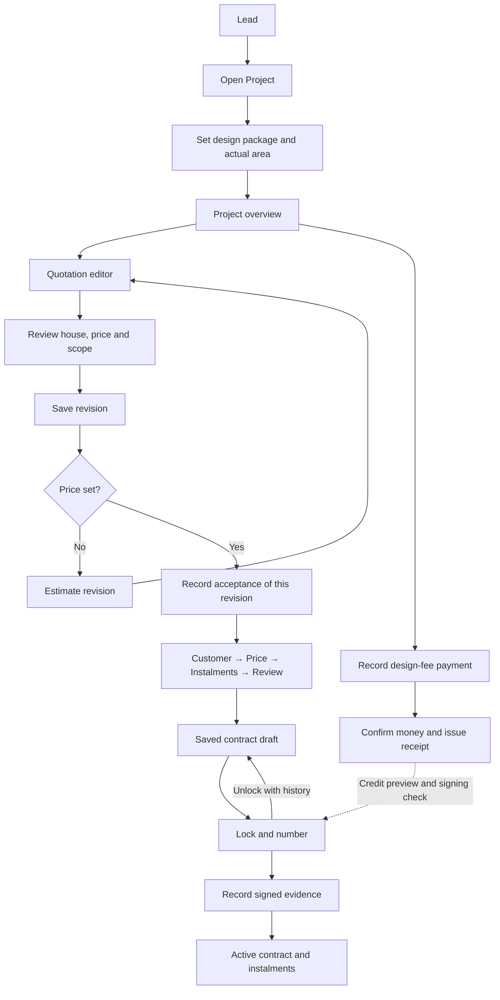

# BKP demo flow alignment

Status: implemented on local Docker; HTTP/SSR checks and synthetic quotation/draft browser lifecycle passed, 2026-11-08. Native print, browser signing and physical-device checks remain unverified.
Scope: BKP opening through quotation, contract drafting and signing, with existing receipt and instalment integration.
Risk: R1 implementation after owner-confirmed business decisions. This document is a plan, not runtime verification.

## Confirmed decisions

- Follow the demo's work sequence and data-entry grouping. Preserve multiple Projects per Lead and immediate entry to design after opening.
- Remove the mandatory generic sales-data/price task before a BKP quotation.
- Allow an unpriced estimate revision. A positive price and evidenced customer acceptance of the selected revision are required for contract preparation.
- First quotation starts with the Project house brief. Further revisions start with the previous quotation; explicit field-level import applies changed brief values.
- Quotation captures house type, stories, bedrooms, kitchens, bathrooms, usable area, total price, specification rows and exclusions.
- Contract wizard has Customer, Price, Instalments, Review steps. Price comes from the selected accepted quotation. A changed price requires a new accepted quotation.
- Save an editable contract draft at the end of the wizard. Locking issues the contract number. Signed evidence activates the agreement and instalments.
- Design-fee collection runs alongside quotation and contracting. Receipt completion is not a contract prerequisite.
- Preserve permissions, actual-money confirmation, partial payments, refunds, document history, exact satang arithmetic and final-backwards design-credit allocation.
- Keep current overview/documents/money navigation and the existing visual tokens. The general navigation remains one task per page.

## Confirmed source facts

Demo:
- Opening and Project defaults: src/components/leads/LeadPrimaryAction.tsx, src/lib/data/projects.ts, src/lib/project-rules.ts.
- Overview and independent receipt work: src/app/(admin)/projects/[id]/page.tsx, src/lib/project-todos.ts.
- Quotation inputs and revisions: src/components/projects/QuotationEditor.tsx, QuotationPanel.tsx, src/lib/quotation-rules.ts, src/lib/data/quotations.ts.
- Four-step draft/lock/sign flow: src/components/contracts/ContractWizard.tsx, src/lib/data/contract-flow.ts.
- Demo data is in-memory and contract clauses contain placeholders. Company contract text remains the configured issuer text.

Current application:
- Opening binds the exact Project and enters design: src/app/walkin/project-actions.ts.
- Mandatory price detour: src/lib/sales/case-progress.ts and src/app/sales/[id]/case-form.tsx.
- Existing quote action only receives description: src/app/sales/agreement-actions.ts and supabase/migrations/20261102175607_sales_bkp_agreements.sql.
- Document snapshots, numbering and replay: supabase/migrations/20261102173413_sales_money_helpers.sql.
- House brief is independently saved per Project: ADR0034.
- Accepted-quotation requirement and financial rules: ADR0028 and docs/sales/sales-to-receipt-business-contract.md.

## User-facing flow

| Screen | Primary action | Secondary action | Result |
| --- | --- | --- | --- |
| Design | Save design agreement | Back to overview | Overview with quotation and design-fee work |
| Quotation | Review quotation | Back, import changed brief values | Review with entered values retained |
| Quotation review | Save revision | Edit details | Saved revision visible in Documents |
| Priced quotation | Record customer acceptance | Create new revision, print | Selected accepted revision can start contract |
| Estimate | Add price in new revision | Print estimate | Priced revision ready for customer review |
| Contract steps 1–3 | Continue | Back | Next step with in-memory values retained |
| Contract step 4 | Save contract draft | Edit section | Persisted draft detail |
| Saved draft | Lock for signing | Edit draft | Numbered printable snapshot |
| Locked contract | Record signed evidence | Print, unlock to revise | Active contract or explicitly reopened draft |
| Signed contract | Next due instalment action | View agreement and receipts | Existing inspection, billing and receipt work |

## UX specification

### Project overview and entry

Opening goes directly to design. Saving design returns to Overview. Show one primary action, Prepare quotation, and a separate secondary action to record design-fee money when permitted. Pending confirmations remain visible as independent work. The action list communicates that both activities are available. The same task's entry card is suppressed while its form is open.

Keep House Brief immediately after Work Information in Overview. House Brief remains available from tasks, documents and money views. Its edit action updates current preferences. Quotation and contract views identify their saved revision and source.

### Quotation task

Use one page with three visible sections:
1. House details, prefilled from the brief for the first revision.
2. Total price with an explicit Price not set choice. Blank is unpriced; a priced quotation must be greater than zero.
3. Specifications and exclusions, with add/remove controls and demo field groupings.

Price is the quote total, with no promotion/discount detour. Show a compact summary and a primary Review quotation action. The review shows customer, house, price state, specifications and exclusions, then Save revision. Back preserves input. Input validation errors stay beside the field, with an error summary and focus on the first invalid field.

A saved unpriced revision reads Estimate — price not set in screen and print. It cannot be accepted or used for a contract. A saved priced revision offers Record customer acceptance. Revision selection is explicit; a newer revision does not silently replace a previously selected accepted revision.

Show changes from current House Brief beside affected fields, with an explicit Use current value action. The action never silently overwrites another edited field. Source labels identify imported values and saved revisions.

After a save, return to Documents with the saved revision and its next action visible. Revisiting an existing revision is read-only; editing starts a new revision.

### Contract task

Use a four-step indicator inside the task page. Each step has a named heading, Back and Continue, and preserved values. On narrow screens use Step N of 4 plus the step name. On desktop show all four names. Completed steps can be revisited. There is one primary action per step.

1. Customer: prefill signer name and phone from the Project customer, with the site address from saved Project data when present. Signer/contact/site edits belong to this contract draft. No automatic customer merge by phone.
2. Price: show accepted quotation number/revision and immutable total, start date, received design-credit preview and resulting schedule total. Change price leads to a new quotation with a warning about unsaved wizard input.
3. Instalments: editable labels, percentages, progress and work description. Default 10% plus five 18% rows at 20/40/60/80/100 progress. Show percentage total and validation beside the schedule. On narrow screens use rows as stacked cards.
4. Review: customer, site, accepted quote, price, start date, credit preview and instalments, each with Edit this section. Save contract draft is the only persistence step for a newly entered wizard.

Once saved, Overview/Documents shows Resume draft. Reloading a saved draft recovers its content. Before the first save, Back/Continue preserves in-memory input. An explicit exit/link action confirms discard. Browser unload uses the native unsaved-change warning. Refresh before the first save has no recovery guarantee.

Draft detail offers Edit draft and Lock for signing. Lock review states that a number and fixed printable version will be created. A locked document offers Print for signing, Record signed evidence, and Unlock to revise. Signed documents use existing adjustment/cancellation workflows.

### Shared interaction and accessibility

Reuse existing CSS tokens and components. Keep data-entry forms single-column except short related fields. Use persistent labels, visible keyboard focus, logical tab order, appropriate input modes, readable THB formatting and 44px touch controls on narrow screens. Sticky action areas must not obscure inputs, error messages or on-screen keyboard interaction.

Preserve entered values after validation, network or stale-version failures. Pending operations disable duplicate submission and show progress. Success identifies the saved revision/draft. Version conflicts offer a reload path with an explicit unsaved-data warning. Dialogs restore focus and keep clear cancellation controls.

## Data and transaction contract

### Quotations

Use the existing document revision/payload infrastructure with backward-compatible optional structured fields. Add server and SQL validation of house data, specification rows, exclusions, size/count limits and integer-satang price.

One atomic quote RPC locks the case, checks permission/brand/status/version, checks request replay, validates payload and creates the snapshot revision. It must not perform a separate client saveCase followed by issueQuotation.

An estimate has an explicit state/payload marker and no agreed construction price. Both acceptance and contract RPCs require a positive quoted total, including legacy zero-price documents. Estimate creation must not set case net price to zero. Source quote and brief identifiers are informational snapshot provenance; snapshot rendering uses stored values.

Acceptance records evidence on that quotation revision. Multiple accepted revisions remain history. Acceptance alone changes neither an existing contract draft nor the case agreed construction total.

The current live contract document, including a saved draft, is the authoritative binding. Its parent_id identifies the selected accepted quotation. Saving a new draft or explicitly selecting another accepted revision in an editable draft atomically sets its payload/parent and the case agreed-price representation from that quotation. Normalize BKP list/promotion/discount consistently so case net equals the bound quotation total. A quote selector belongs only in the editable draft; selection previews the new immutable quote price/specifications and recalculates the editable schedule for review before Save draft. Save checks the accepted revision again under the case lock.

A newly accepted revision never silently replaces that binding. Locked contracts first require Unlock to revise; signed contracts use the existing adjustment path. Lock and sign recheck the bound quote identity, positive total, case total and schedule total. Before a contract draft exists, Overview labels the construction contract price as not yet set and shows accepted quotation references in Documents. Existing contract-free legacy case price can remain stored as a provisional value but must not appear as an accepted contract total. Keep old document snapshots unchanged.

### Contract drafts and locking

Reuse sales_documents kind=contract, state=draft, its version, parent quotation reference and payload. The existing helper skips numbering for drafts and the existing guard allows draft payload edits while protecting non-draft snapshots. A draft remains unnumbered. No second draft store is required.

Under the case lock, creation rejects another live contract document in draft, awaiting_signature or signed state. Add a compatible uniqueness safeguard for these states after inspecting existing local data for conflicts; conflicts require a concrete resolution decision, never silent selection/deletion. Existing accepted quotation revisions are independent of this single live contract chain.

Draft save/edit checks current financial preparation permission, case lifecycle/version, document version and selected accepted quote. Persist signer/contact/site/start date/schedule and the accepted quote reference. The price and specifications come from that accepted revision. Draft edits increment document and case versions and preserve request replay. Document loading exposes draft version to the editor.

Locking is atomic under the existing case lock. Recheck draft/quote/lifecycle/version and agreed-price binding, calculate current net design receipts and credit allocation, allocate a number from the existing contract sequence, and transition that draft to awaiting_signature with its final printable payload. The existing draft guard permits this final payload update from draft; the resulting non-draft payload is immutable. Retry returns the same result and number.

Before signing, recompute relevant financial facts under the same lock. If design receipts/refunds changed the printed credit or schedule, reject signing and instruct Unlock, review and lock again. The final signed snapshot must equal the version printed for signing.

Unlock atomically marks the numbered awaiting-signature document cancelled/void with a reason and creates a new unnumbered draft copied from that snapshot. Keep parent_id bound to its accepted quote and retain replaces_document_id provenance to the voided contract. A subsequent lock allocates a new number. Signed or already superseded documents cannot be unlocked. Unlock uses current financial preparation permission and rechecks the case lifecycle. Case locking plus the one-live-contract invariant prevents simultaneous sign/unlock or duplicate replacement drafts.

Signing validates evidence, version and snapshot consistency, then uses existing instalment activation and credit logic atomically. No active instalments arise from draft save or lock alone.

### Compatibility and migration

Keep new structured read fields optional for historical documents. Legacy awaiting-signature and signed contracts remain readable and printable from their existing payloads.

Legacy awaiting-signature documents follow the existing sign operation, including its parent accepted quote, case version, evidence and credit-freshness checks. The same case lock and positive quote/price-binding checks apply. A valid legacy document can sign directly without creating a draft. A legacy price/parent/credit mismatch gives an actionable Unlock and review path. Unlock uses the same atomic void-and-create-draft operation described above, copying legacy payload fields with optional structured defaults. Existing signed contracts retain their snapshot and existing adjustment rules. No backfill rewrites their values or numbers.

If an old quote lacks house/specification data, print its saved description through the historical renderer fallback. The editor can add structured data only in a new revision. Drafts cloned from legacy contracts retain captured legacy scope and issuer text; missing newly required values must be completed before locking.

The generic edit-case remains available for exception corrections, with BKP agreed-price fields protected once an accepted quote/locked/signed contract governs them. Taraville keeps its own pricing and reservation flow.

Use explicit RPC signatures with coordinated caller changes and grants. When replacing a signature, remove the old public/private signatures to prevent ambiguous overloads, after dependency checks. Use Supabase CLI migration creation. Apply only to the authorized isolated local stack during implementation. Production execution needs separate approval.

## Implementation slices

1. Record accepted workflow ADR and plan review. Establish baseline checks and synthetic fixtures.
2. Quotation vertical slice: structured fields, atomic create/revision/acceptance, optional price, read/print compatibility, recommendations without edit-case detour.
3. Contract vertical slice: four-step entry, versioned editable drafts, lock/unlock/numbering, accepted quote bindings and historical documents.
4. Signing/credit integration: snapshot freshness, evidence, activation, retries/concurrency, existing payment/refund invariants.
5. Full local browser acceptance, demo comparison and documented limitations.

Each slice includes its UI, actions/RPCs, loading/parsing, task guards, rendering and meaningful checks. Do not release an intermediate UI against missing RPC signatures.

## Acceptance evidence

- Existing task/progress/opening/finance checks remain meaningful after updating input contracts.
- Actual HTTP tests cover unpriced revisions, positive acceptance, selected-revision identity, quote atomicity, permissions, request replay and stale writes.
- Quote structured values survive parsing and screen/print rendering; older snapshots still render.
- First-quote prefill and per-field import preserve unsaved values. New revision derives from the previous revision.
- New contract wizard back/edit/exit, error retry and saved-draft reload.
- Lock replay and parallel clicks issue one number. Unlock preserves voided number/history, re-lock issues a new number. Sign/unlock races preserve one coherent outcome.
- Changed design payment/refund after lock prevents signing an obsolete printed schedule. Signing creates exactly one active instalment set and preserves accepted total and exact credit.
- Legacy awaiting-signature contracts sign directly when valid, or use atomic unlock/review/relock when stale. Existing signed contracts remain printable.
- Accept Q1, save its contract draft at price A, then accept Q2 at price B. Summary/draft remain at A. Explicit draft rebind to Q2 changes parent, payload and case total to B together. Locked/signed bindings reject direct rebind.
- One live contract chain is enforced for existing and new records, including concurrent draft creation, stale legacy links and sign/unlock races.
- Browser at desktop and 375px with keyboard, errors and print previews. Ask the owner at the verification point per agent-guide section 4.
- Tests use synthetic localhost data. No production readiness claim follows from plan scrutiny.

## UX guidance applied

UI UX Pro Max searches matched multi-step progress indicators, submit feedback, labelled fields, announced errors and recovery actions. Next.js guidance matched server mutations and validation. Existing design tokens and framework conventions govern implementation.

## Independent scrutiny record

Round 1 verdict: fix-then-ship for plan readiness. Three findings were addressed in this revision:
1. Reused existing editable draft documents and their immutability transition, removing the proposed second store.
2. Defined the live contract document parent as the authoritative quotation binding, with atomic draft rebind and case-price synchronization. Acceptance alone preserves existing bindings.
3. Defined direct legacy signing and atomic void-and-reopen, with one-live-contract protection and historical rendering.

Round 2 verdict: ship for plan readiness. The reviewer traced the revised document binding, draft/lock/unlock behavior and legacy signing paths against the current source. No remaining material plan blocker was found. Implementation must still prove schema guards, caller compatibility, actual HTTP behavior and browser UX. This verdict does not certify runtime correctness.

## Local implementation evidence

See .docs/SESSIONLOG-bkp-demo-flow-implementation-2026-11-08.md for implementation/HTTP evidence and .docs/SESSIONLOG-bkp-demo-flow-browser-2026-11-08.md for quotation/draft browser checks, the snapshot parsing fix and remaining verification limits.
